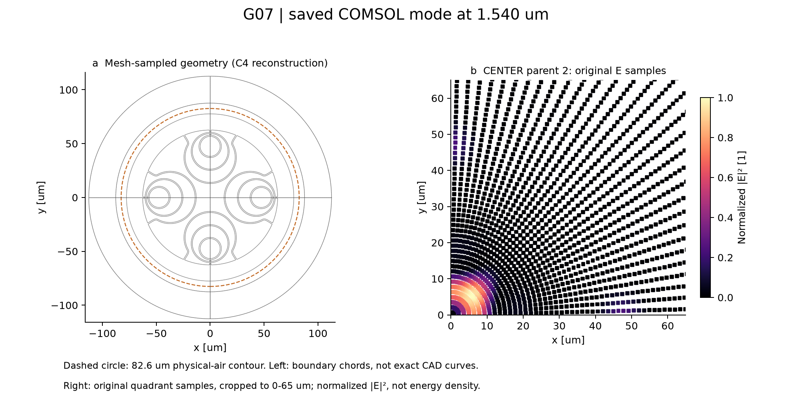
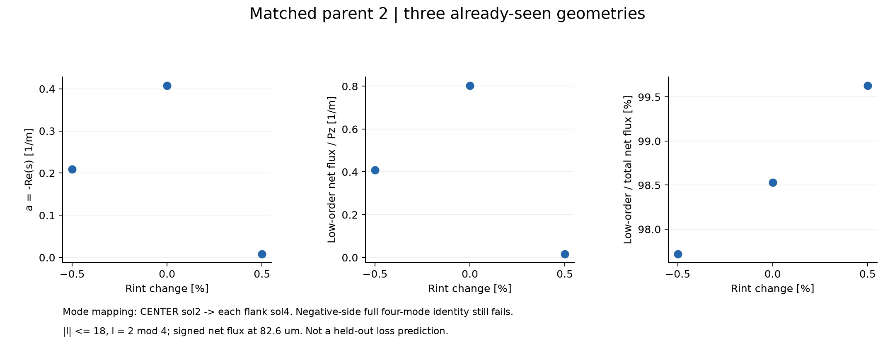
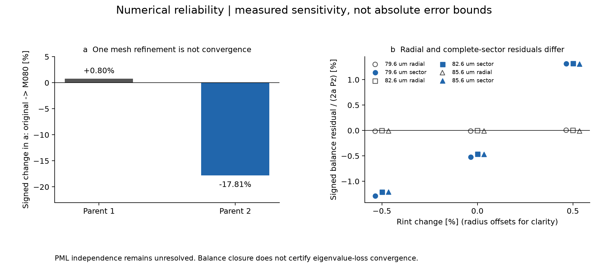

# Hollow-Core Fiber Numerical Study

**真实COMSOL保存解上的光学数值案例：几何扰动、HOM响应与数值可靠性。**

本项目展示C4集成管反谐振空芯光纤G07在1.540 μm处的模态分析与后处理。使用CENTER和Rint±0.5%的既有全波计算，不是人工数据演示，也不是已经验证的B/R损耗预测模型。

## 案例与工作流程

参数化几何与C4扇区 → EWFD复本征模式 → 保存复谱与E/H → 场重叠身份匹配 → 有符号Poynting与角谱处理 → 网格/功率一致性检查。

|工程环节|本案例展示|
|---|---|
|光学建模|实际求解的C4结构、物理空气域、玻璃、PML和复传播约定|
|数据分析|匹配模式的复谱、低阶净泄漏、轴向功率归一化和复场谐波|
|数值验证|身份竞争、角谱/直接通量一致性、周期侧边贡献和网格敏感性|
|结果追溯|公开最小派生数据、来源SHA256、重画脚本及限制说明|

这是协作及AI辅助研究的整理案例；个人与团队具体贡献仍待核实，不声明申请者独立编写全部代码、独立完成全部研究或开发COMSOL求解器。

## 1. 几何与基准模态



左图来自同源历史网格中的几何边界线段，经C4旋转重建；包括周期扇区接缝，不是精确CAD曲线。虚线为82.6 μm物理空气轮廓。右图显示CENTER父态2原始观察点上的归一化`|E|²`，裁剪至0–65 μm，不插值；它不是电磁能量密度。完整CSV保留2304个原始观察点的标量强度，而非完整复场。

## 2. 已见几何的HOM响应



沿用历史场重叠匹配：CENTER sol2 → 两侧各自sol4。三个模型的幅度衰减率`a = -Re(s)`约为 **0.20923、0.40793、0.008095 m⁻¹**；对应的低阶净通量比例约为97.72%、98.53%、99.63%。

这表明该匹配模式在已见几何下具有明显非线性响应，**不是留出预测或结构优化成功**。Rint变化同时包含CAD圆心随动；低阶通量与总衰减受功率守恒约束，它们的相关性不是局域共振、干涉或因果机制的独立证据。

负侧父态2匹配通过，但**整体四目标身份失败**仍保留；正侧原FM退化约束也未通过。不以损耗最接近原则挑选模式，不把失败分支补成连续曲线。

## 3. 数值可靠性：哪些通过，哪些没有



- 原网格→M080对照中，父态1/2衰减有符号变化约 **+0.80% / −17.81%**。身份匹配稳定，不等于绝对损耗收敛；只有两档网格。
- 径向平衡残差与加入C4周期侧边净流的完整扇区残差分别报告，不假定周期侧边误差为零。
- 公开的父态2九组轮廓数据中，角谱净流恢复相对差最大约`1.37e-5`。这只是保存场的积分一致性，**不是FEM损耗误差界**。
- PML独立性及绝对损耗可靠性仍未充分认证。B/R优势、独立辐射通道、Fano/BIC/异常点等不在本案例结论内。

## 离线复核与重画

仅复核已授权派生数据，不启动COMSOL。已实际验证：Windows / Python3.13.1、NumPy2.5.4、matplotlib3.11.2；其他平台及版本未实测。

```powershell
python -m venv .venv
.\.venv\Scripts\python.exe -m pip install -r requirements.txt
.\.venv\Scripts\python.exe -I -B scripts/validate_case.py
.\.venv\Scripts\python.exe -I -B scripts/plot_case.py --out reproduced
```

绘图输出目录必须尚不存在；不会覆盖历史图。`validate_case.py`核查谱符号、身份列、低阶复系数功率恢复、残差分解、网格相对变化和已封存文件SHA256。它不验证完整Maxwell解，不能引用工具包的118项测试作为本研究的验收。

```text
data/derived/    经授权最小CSV、来源哈希与解身份
figures/        三张核心图，PNG及可编辑SVG
scripts/        独立离线核验与重画，不含物理求解器
docs/           方法、数据契约、限制、来源和本轮核验记录
manifest.json   相对路径与SHA256
```

完整建模重跑需要原始模型、更多配置及合法COMSOL产品许可，本仓库不承诺一键重跑。MPH、完整E/H、矩阵、网格、原始日志和第三方资料不发布。

详见[方法与数据契约](docs/methods.md)、[局限](docs/limitations.md)、[来源与授权](docs/provenance.md)、[离线核验](docs/validation.md)。仓库当前版本不再包含通用Python工具包；旧版本保留在Git历史中。
